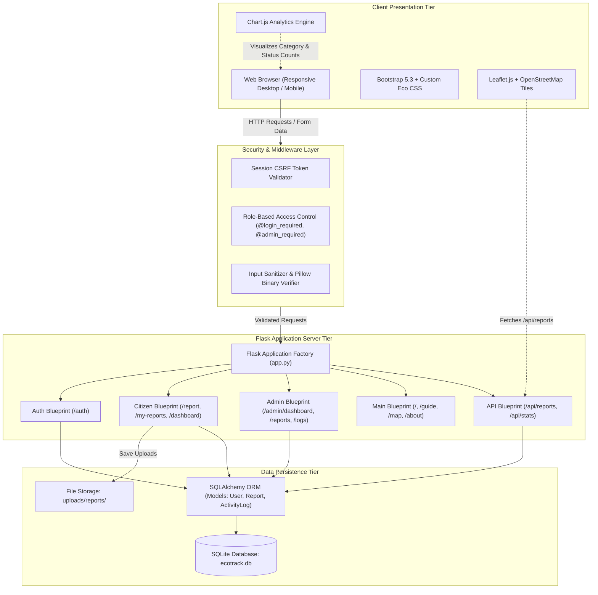

# 7. System Architecture

## 7.1 Architecture Overview
EcoTrack follows a modular, Model-View-Controller (MVC) oriented architecture implemented via Flask Blueprints, Jinja2 templates, SQLAlchemy ORM, and client-side visualization libraries.

## 7.2 Architectural Component Descriptions

1. **Client Tier:**
   - **HTML5 & Bootstrap 5.3:** Renders responsive grids, modal dialogs, and clean typography.
   - **Leaflet.js:** Lightweight open-source JavaScript mapping library consuming OpenStreetMap raster tiles for rendering dynamic, color-coded hotspot markers.
   - **Chart.js:** HTML5 canvas charting library providing category doughnuts and status funnel bar charts.

2. **Security & Middleware Tier:**
   - **CSRF Token Handler:** Protects state-altering POST requests against cross-site attacks using secret hex tokens stored in user sessions.
   - **RBAC Decorators:** Validates authentication status and checks whether `session['user_role'] == 'admin'` before allowing access to administrative consoles.
   - **Pillow Image Validator:** Verifies image headers and strips unneeded metadata to neutralize potential script injections.

3. **Application Server Tier:**
   - **Blueprints:** Decomposes routes into independent modules (`auth`, `citizen`, `admin`, `main`, `api`) for clean maintainability.
   - **Jinja2 Templating Engine:** Safely renders dynamic server-side views with automatic HTML escaping.

4. **Data Persistence Tier:**
   - **SQLAlchemy ORM:** Provides an abstraction layer with parameterized queries, preventing SQL injection vulnerabilities.
   - **SQLite Database:** Zero-configuration, serverless, atomic SQL database engine stored in local file `ecotrack.db`.
   - **Uploads Directory:** Dedicated physical storage directory for user-submitted photographs with unique UUID identifiers.

