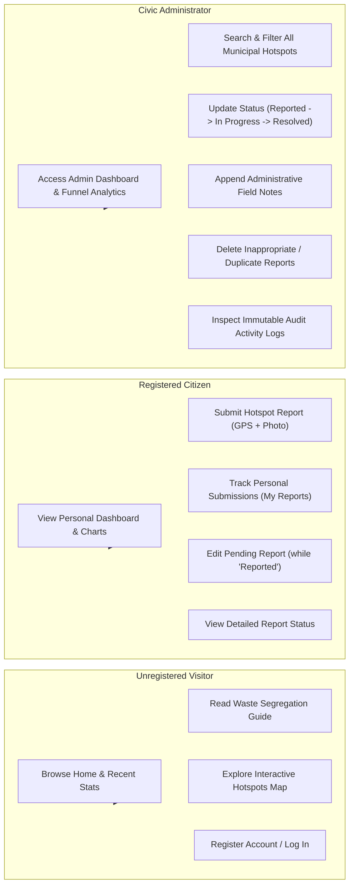

# 8. Use-Case Diagram and Specifications

## 8.1 System Actors
1. **Unregistered Visitor (Guest):** Public citizen browsing general information, the live hotspot map, and the educational waste segregation guide.
2. **Registered Citizen:** Authenticated resident who identifies and reports waste hotspots, tracks personal submissions, and updates pending reports.
3. **Civic Administrator:** Municipal sanitation officer or conservancy supervisor responsible for reviewing complaints, dispatching crews, updating status, and auditing interventions.

---

## 8.2 Use-Case Interaction Model

---

## 8.3 Detailed Use-Case Descriptions

### UC-01: Report Waste Hotspot
- **Primary Actor:** Registered Citizen
- **Preconditions:** Citizen must be logged in.
- **Main Flow:**
  1. Citizen navigates to the Report Waste form (`/report`).
  2. Citizen enters title, selects category (Wet, Dry, Plastic, E-waste, Mixed, Other), and enters landmark.
  3. Citizen drops a pin on the interactive Leaflet map or clicks "Use My Current Location".
  4. Citizen describes the dumping scale and optionally selects a photo (< 5MB).
  5. System validates CSRF token, text lengths, coordinate ranges, and image binary integrity.
  6. System saves record with initial status `Reported` and redirects to the confirmation page.
- **Postconditions:** A new complaint ID is assigned and visible on the map and citizen dashboard.

### UC-02: Update Report Status & Field Notes
- **Primary Actor:** Civic Administrator
- **Preconditions:** User must have active administrative session (`role == 'admin'`).
- **Main Flow:**
  1. Administrator reviews unassigned complaints on `/admin/reports` or `/admin/dashboard`.
  2. Administrator selects "Update Status" modal or reviews the detail page.
  3. Administrator changes status to `In Progress` or `Resolved` and enters field action notes (e.g., "Assigned to Ward G/North cleanup crew").
  4. System updates report record, modifies `updated_at` timestamp, and automatically generates an `ActivityLog` entry.
- **Postconditions:** Citizen and public map views reflect updated status and notes immediately.

