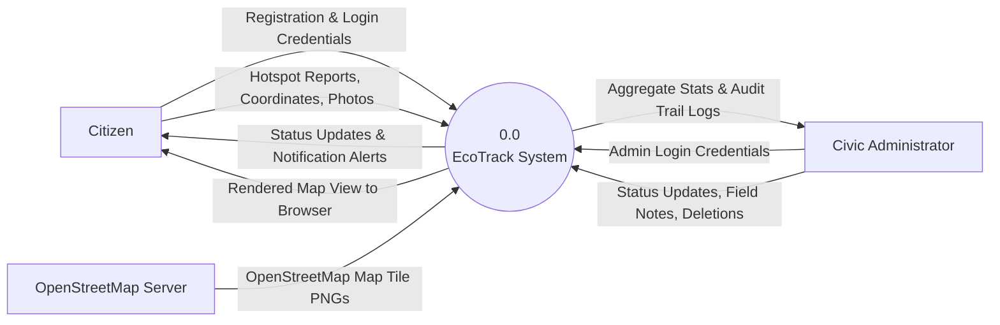
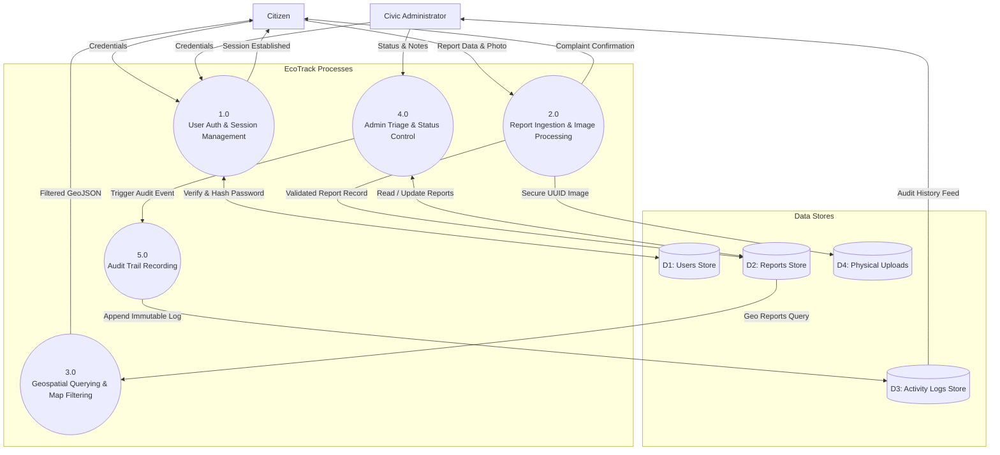

# 9. Data-Flow Diagrams (DFD)

## 9.1 DFD Level 0 — Context Diagram
The Level 0 context diagram demonstrates the boundary of the EcoTrack application with respect to external entities: Citizens, Civic Administrators, and OpenStreetMap.

---

## 9.2 DFD Level 1 — Detailed Process Decomposition

---

## 9.3 Data Dictionary Summary
- **User Record:** `{id, name, email, password_hash, role, created_at}`
- **Report Record:** `{id, user_id, title, description, category, location, latitude, longitude, image_filename, status, admin_notes, is_demo, created_at, updated_at}`
- **Activity Log Record:** `{id, admin_user_id, report_id, action, details, created_at}`
- **Uploaded Image Payload:** `{uuid_filename, raw_bytes, mime_type, file_size}`

