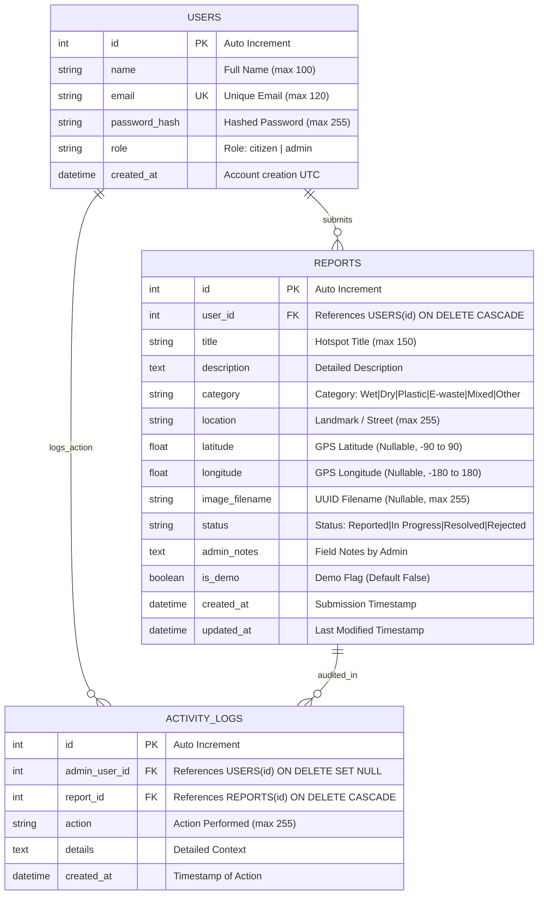

# 10. Entity-Relationship (ER) Diagram and Database Schema

## 10.1 Entity-Relationship Diagram



---

## 10.2 Relational Schema & Constraints

### 1. `users` Table
```sql
CREATE TABLE users (
    id INTEGER PRIMARY KEY AUTOINCREMENT,
    name VARCHAR(100) NOT NULL,
    email VARCHAR(120) NOT NULL UNIQUE,
    password_hash VARCHAR(255) NOT NULL,
    role VARCHAR(20) NOT NULL DEFAULT 'citizen',
    created_at DATETIME NOT NULL
);
CREATE UNIQUE INDEX ix_users_email ON users (email);
```

### 2. `reports` Table
```sql
CREATE TABLE reports (
    id INTEGER PRIMARY KEY AUTOINCREMENT,
    user_id INTEGER NOT NULL,
    title VARCHAR(150) NOT NULL,
    description TEXT NOT NULL,
    category VARCHAR(50) NOT NULL,
    location VARCHAR(255) NOT NULL,
    latitude FLOAT,
    longitude FLOAT,
    image_filename VARCHAR(255),
    status VARCHAR(30) NOT NULL DEFAULT 'Reported',
    admin_notes TEXT,
    is_demo BOOLEAN NOT NULL DEFAULT 0,
    created_at DATETIME NOT NULL,
    updated_at DATETIME NOT NULL,
    FOREIGN KEY(user_id) REFERENCES users (id) ON DELETE CASCADE
);
CREATE INDEX ix_reports_user_id ON reports (user_id);
CREATE INDEX ix_reports_category ON reports (category);
CREATE INDEX ix_reports_status ON reports (status);
CREATE INDEX ix_reports_created_at ON reports (created_at);
```

### 3. `activity_logs` Table
```sql
CREATE TABLE activity_logs (
    id INTEGER PRIMARY KEY AUTOINCREMENT,
    admin_user_id INTEGER,
    report_id INTEGER,
    action VARCHAR(255) NOT NULL,
    details TEXT,
    created_at DATETIME NOT NULL,
    FOREIGN KEY(admin_user_id) REFERENCES users (id) ON DELETE SET NULL,
    FOREIGN KEY(report_id) REFERENCES reports (id) ON DELETE CASCADE
);
CREATE INDEX ix_activity_logs_admin_user_id ON activity_logs (admin_user_id);
CREATE INDEX ix_activity_logs_report_id ON activity_logs (report_id);
CREATE INDEX ix_activity_logs_created_at ON activity_logs (created_at);
```

---

## 10.3 Referential Integrity and Optimization
- **Cascade Deletion:** If a user account is deleted, personal reports are cascaded safely. If a report is deleted, all dependent audit logs are purged or disassociated without leaving orphaned foreign key violations.
- **Indexes:** Strategic B-tree indexes are maintained on `reports.status`, `reports.category`, and `users.email` to guarantee sub-millisecond query responses under multi-user access.

