# 11. Weekly Gantt Chart (8-Week Implementation Schedule)

This 8-week implementation timeline adheres to the University of Mumbai Bachelor of Engineering Semester VII Open Source Software Development Lab schedule.

---

## 11.1 Visual Implementation Timeline

```mermaid
flowchart LR
    W1["Week 1: Survey & Git Setup"] --> W2["Week 2: Requirements & ER Modeling"]
    W2 --> W3["Week 3: Auth & Database Backend"]
    W3 --> W4["Week 4: Reporting & Upload Pipeline"]
    W4 --> W5["Week 5: Leaflet OSM Mapping"]
    W5 --> W6["Week 6: Admin Triage & Audit Logs"]
    W6 --> W7["Week 7: Analytics & pytest Suite"]
    W7 --> W8["Week 8: Documentation & University Demo"]
```

---

## 11.2 Detailed 8-Week Breakdown Table

| Week | Phase / Focus Area | Key Deliverables & Activities | Student Primary Lead |
| :---: | :--- | :--- | :--- |
| **Week 1** | **Problem Definition & Open Source Setup** | Literature survey on municipal waste in Mumbai; study CPHEEO and SWM 2016 rules; initialize Git repository with MIT License, `.gitignore`, and branch protection. | All Students (Led by Student 1) |
| **Week 2** | **System Analysis & Software Modeling** | Formulate Functional & Non-Functional requirements; design Use-Case, DFD Level 0/1, and ER diagrams; define SQLite relational schema. | Student 2 & Student 3 |
| **Week 3** | **Database & Authentication Core** | Implement Flask application factory (`create_app`), SQLAlchemy models (`User`, `Report`, `ActivityLog`), password hashing (`scrypt`), and session login/registration. | Student 1 (Backend Lead) |
| **Week 4** | **Hotspot Reporting & Upload Pipeline** | Build responsive reporting form with Bootstrap 5; implement client-side size limits; develop secure backend file upload pipeline using Pillow binary verification. | Student 2 & Student 1 |
| **Week 5** | **Geospatial Mapping Engine** | Integrate Leaflet.js with OpenStreetMap raster tiles; build `/api/reports` JSON endpoint; implement status-colored pins, popups, and click-to-pin coordinate picker. | Student 4 (Maps Lead) |
| **Week 6** | **Administrative Console & Audit Trail** | Develop admin dashboard, status triage workflow (Reported &rarr; In Progress &rarr; Resolved), field notes modal, and automated `ActivityLog` logging. | Student 1 & Student 4 |
| **Week 7** | **Analytics, Testing & Accessibility** | Integrate Chart.js doughnut and bar charts; develop 34 automated unit and integration tests using `pytest`; conduct WCAG accessibility review. | Student 3 (Testing Lead) |
| **Week 8** | **Documentation & University Defense** | Compile Mumbai University project report, weekly logbook records, demo seed scripts, user manual, and deliver project defense presentation. | All Students (Coordinated by Student 3) |

